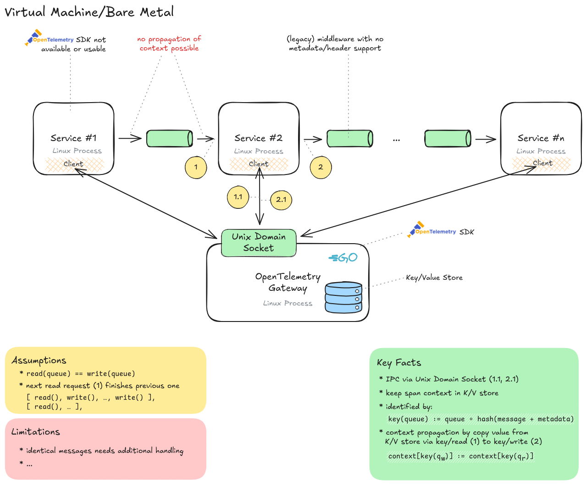

# Talk: OpenTelemetry - Retrofit a custom, legacy C middleware

From the OpenTelemetry Homepage:

> **OpenTelemetry** is an open source observability framework for cloud native software. It provides a single set of APIs, libraries, agents, and collector services to capture distributed traces and metrics from your application.



## Slides

Slides are build with [Vite](https://vitejs.dev/) and [reveal.js](https://revealjs.com/).

```bash
$ npm install
$ npm run dev
```

Open [http://localhost:5173/](http://localhost:5173/) in a browser.

## Create PDFs

> [!IMPORTANT]
> [AppArmor User Namespace Restrictions vs. Chromium Developer Builds](https://chromium.googlesource.com/chromium/src/+/main/docs/security/apparmor-userns-restrictions.md)

```shell
# echo 0 | sudo tee /proc/sys/kernel/apparmor_restrict_unprivileged_userns
npm install
npm run build
nohup npm run preview &
npm run pdf -- "$(jq -r .name < package.json).pdf" 4173 false
npm run pdf -- "$(jq -r .name < package.json).printable.pdf" 4173 true
pkill --signal TERM --exact "npm run preview"
```
